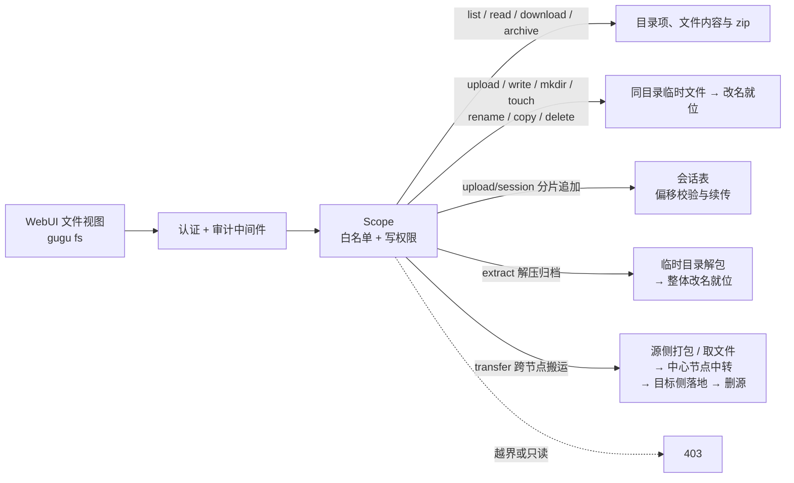
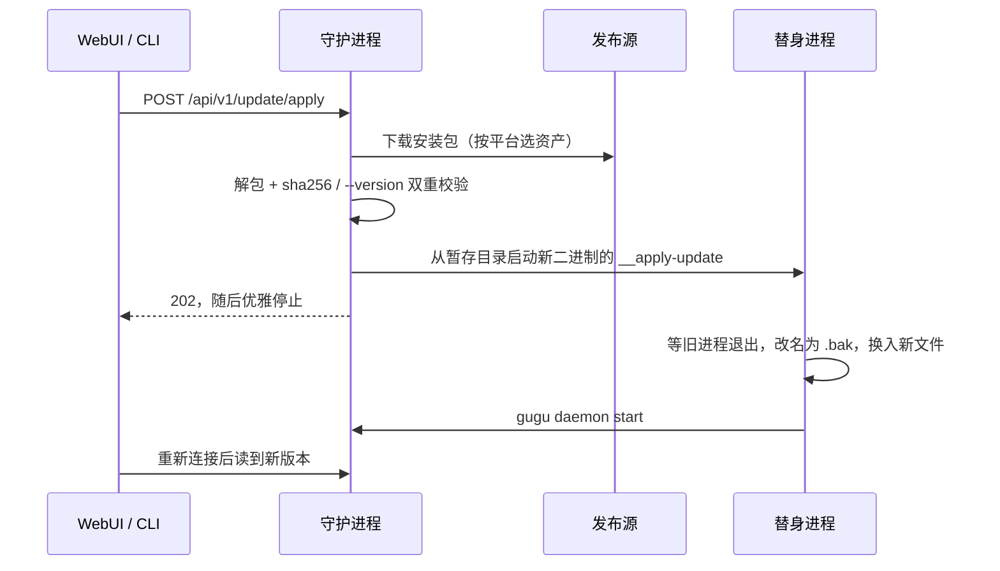

# GuguGuard (咕咕鸽进程守护)

[English](./README_EN.md)

跨平台进程守护与管理工具，使用 Rust 构建。通过 CLI 和 WebUI 管理你的服务进程。

## 功能特性

- **进程管理** — 启动、停止、重启、自动重启、崩溃恢复
- **Web 管理面板** — 暗色主题 UI，动态表单，实时状态更新
- **命令行工具** — 完整的 CLI，支持彩色表格输出
- **日志捕获** — stdout/stderr 自动捕获，内存环形缓冲区 + 文件持久化 + 自动轮转
- **健康检查** — TCP 端口 / HTTP 请求检测，连续失败达到阈值才判定重启，瞬时抖动不误伤
- **崩溃历史** — 最近 5 次退出（时间、退出码、是否被自动拉起）在卡片与 API 都能看到；每次启动/退出/拉起另外追加到 30 天滚动日志，跨守护重启保留，可算可用率与崩溃频次
- **资源监控** — 按进程树采样 CPU/内存（含 conhost 等子进程），卡片与 `/metrics` 可见；`max_memory_mb` 超限自动重启，防内存泄漏
- **资源硬限（cgroup v2 / Job Object）** — Linux 下每个进程独占一个 cgroup，`cpu_max` / `memory_max` / `pids_max` 由内核执行：内存越界整组 OOM、任务数封顶，启动前生效，退出即清理；Windows 下同一组字段落到进程树的 Job Object（CPU 速率硬顶、提交内存上限、活动进程数上限）
- **指标时序** — 每分钟一桶保留 24 小时，CPU/内存均值与峰值、连接数随 WebUI「指标」面板与 `GET /api/v1/processes/:name/history` 查看
- **端口预检与连接数** — 配置 `listen_ports` 后启动前检查端口是否被别的进程占用（占用时直接失败并报出占用者），运行中统计这些端口上的已建立连接数
- **就绪探针** — `depends_on` 现在等上游真的可用（健康检查通过或端口进入监听）再拉起下游，最多等 `ready_timeout_secs`
- **日志告警** — 命中关键字、或短时间内输出刷屏，按冷却时间推送通知，避免重试风暴刷爆机器人
- **日志结构化与检索** — 每行解析出级别、正文、结构化字段与行内时间（JSON / logfmt / 文本启发式），日志面板带级别徽标与字段胶囊；按级别、关键字、输出流检索落盘的日志文件，返回命中与扫描范围
- **操作审计** — 谁在何时对哪个进程做了什么：写操作（启停、增删改、重载、停止守护）连同结果、来源、客户端与耗时追加到 `logs/audit.jsonl`，保留 90 天；WebUI「操作审计」与 `gugu audit` 可按动作、结果、时间、关键字筛选
- **WebUI 内置终端** — 浏览器里打开一个真实 PTY（Windows ConPTY / Unix openpty）：`cd`、分页器、彩色输出与交互式程序都照常工作，输出实时流式回传。默认关闭，开启后受 API Key 与回环监听两道安全门槛约束；单实例最多 4 个会话，空闲 30 分钟自动关闭，打开与关闭写入操作审计
- **多节点** — 一台中心节点纳管多台跑着 gugu 的机器：`[[nodes]]` 里写上从节点地址与 Key，WebUI 顶栏切换后直接启停进程、看日志、改配置；节点表每 5 秒探测在线状态与延迟，REST 代理与 WebSocket 中继都由中心节点完成，从节点零改动
- **整机带宽** — 所有物理网卡合计的上下行速率，顶栏与指标面板展示，`/metrics` 暴露
- **版本更新** — 侧栏版本号即入口：检查最新发布、一键下载安装、替换后自动重启；自动更新可设为关闭 / 仅检查 / 自动安装，来源支持 GitHub、Gitee 与自建清单
- **异常通知** — 退出后不再拉起 / 健康判定不健康 / 被自动拉起 / 内存超限 均可推送到钉钉、企微、飞书自定义机器人或自建 webhook
- **直接执行** — 命令默认不经 shell 直接启动，带空格/特殊字符的参数不会被拆碎或注入；需要 shell 特性时设 `shell = true`
- **文件管理** — 白名单目录内的浏览器：目录浏览、文本预览（UTF-8 / GBK 自动解码）、原始文件下载与目录打包下载（zip 流式）、上传（拖拽、整目录、大文件分片续传、实时进度与取消）、归档解压（zip / tar / tar.gz，解到旁边的同名目录，覆盖需确认）、剪切与粘贴（同节点即移动，跨节点由中心节点搬运）、新建目录与空文件、改名/移动、复制、删除；写操作默认关闭，开启后受白名单与 API Key 双重约束，所有写操作进审计
- **文件浏览器** — 服务端文件浏览，快速选择工作目录和可执行文件
- **API Key 认证** — 可选的 API Key 保护，WebUI 登录界面
- **CORS 配置** — 可限制允许的跨域来源
- **进程依赖** — `depends_on` 配置启动顺序，支持拓扑排序
- **配置热重载** — SIGHUP (Linux) 或 `POST /api/v1/reload` 重新加载配置
- **智能更新** — 修改非运行时配置（日志路径、重启策略等）不重启进程
- **绿色部署** — 配置默认跟着程序走，日志/PID 也在程序目录，整个文件夹搬走即用
- **开机自启** — 系统级（Windows 任务计划程序 / Windows 服务 / Linux systemd）与用户级（无需管理员）三种模式，支持 `--dry-run` 预览
- **防多实例** — PID 文件锁
- **优雅退出** — Ctrl+C / SIGTERM / SIGHUP 信号处理
- **跨平台** — Windows & Linux

## 快速开始

### 安装

**方式一：从源码编译**

```bash
git clone https://gitee.com/hongweifei/gugu-guard.git
cd gugu-guard
cargo build --release
# 二进制文件在 target/release/gugu
```

**方式二：cargo install**

```bash
cargo install --git https://gitee.com/hongweifei/gugu-guard.git
```

**方式三：下载预编译绿色包**

到 Releases 下载对应平台的压缩包（`gugu-windows-x86_64.zip` / `gugu-linux-x86_64.tar.gz`），解压即用。
包内只有一个可执行文件加许可与示例配置——**配置、PID、日志都会在首次运行时生成在程序同目录**，
整个文件夹可以随意搬移。

编译后只需一个 `gugu` 可执行文件，WebUI 已内嵌在二进制中，无需额外文件。

### 配置文件（绿色部署）

配置**默认跟着程序走**。启动时按以下顺序寻找，找不到会自动在程序目录生成一份带注释的模板：

1. `-c` 显式指定的路径（优先级最高）
2. **程序同目录**下的 `gugu.toml`（推荐位置）
3. 当前目录下的 `gugu.toml`（方便在源码目录直接运行）

配置里的相对路径（日志、PID、工作目录）都以**配置文件所在目录**为基准，因此整个文件夹可以随程序一起搬走，无需改配置：

```
gugu-guard/
├── gugu.exe        # 单文件即可，WebUI 已内嵌
├── gugu.toml       # 首次运行自动生成在程序旁边
├── gugu.pid
└── logs/           # 进程日志也统一放这里
```

也可以手动复制示例配置再编辑：

```bash
cp config.example.toml gugu.toml
```

编辑 `gugu.toml`：

```toml
[daemon]
# api_key = "your-secret-key"   # 可选，设置后 API 和 WebUI 需要认证

[daemon.web]
addr = "0.0.0.0"
port = 9090
# cors_origins = ["http://localhost:3000"]  # 可选，限制跨域来源

[processes.my-app]
command = "node app.js"
working_dir = "/home/user/my-project"
auto_start = true
auto_restart = true
max_restarts = 3
restart_delay_secs = 5
max_log_size_mb = 10             # 日志文件超过 10MB 自动轮转
stdout_log = "logs/my-app-stdout.log"
stderr_log = "logs/my-app-stderr.log"
listen_ports = [8080]            # 端口预检 + 连接数统计 + 依赖就绪判断
depends_on = ["my-db"]           # 等 my-db 真的可用后再启动

[processes.my-app.health_check]
type = "tcp"
port = 8080
interval_secs = 30
timeout_secs = 5
# unhealthy_restart = true       # 健康检查失败时自动重启
```

### 启动守护进程

```bash
# 前台运行 (自动读取程序同目录的 gugu.toml，首次运行会生成)
gugu run

# 指定配置文件
gugu run -c /path/to/config.toml

# 通过 CLI 参数设置 API Key (优先级高于配置文件)
gugu --api-key "your-secret-key" run
```

打开浏览器访问 `http://localhost:9090` 即可使用 Web 管理面板。

### 开机自启

三种模式，按「要不要管理员 / 要不要未登录也跑」选：

| 模式 | 适用 | 权限 | 行为 |
|---|---|---|---|
| `--mode task`（默认） | Windows / Linux | 需管理员 | Windows 任务计划程序（`onstart`，SYSTEM 身份）/ Linux systemd 系统单元 |
| `--mode service` | 仅 Windows | 需管理员 | Windows 服务（自动启动 + 崩溃阶梯重启 5s/10s/30s） |
| `--mode user` | Windows / Linux | **无需管理员** | 当前用户登录自启：Windows Run 键 / Linux `systemd --user`（配合 `loginctl enable-linger` 可未登录也起） |

```bash
# 系统级（需管理员 / sudo）
gugu install                       # Windows: 任务计划程序 (开机启动)
sudo gugu install                  # Linux: systemd 系统单元 (开机启动)
gugu install --mode service        # Windows: 注册为 Windows 服务

# 用户级（不需要任何特权，登录即启）
gugu install --mode user

# 先预览将要写入/执行的内容，不改动系统
gugu install --mode task --dry-run
gugu uninstall --dry-run
```

安装时会先做**权限预检**（不满足会直接告诉你改用 `sudo`/管理员，或改用 `--mode user`），
安装后**回读真实状态**（`systemctl is-enabled` / `schtasks /query` / `reg query` / `sc query`），
卸载对「本来就没装」保持容错；`--dry-run` 只打印计划，不碰系统。

> 含空格的安装路径也能正常工作：systemd 单元与 Windows 自启命令里的路径都做了引号包裹。

### 配置热重载

```bash
# Linux: 发送 SIGHUP 信号
kill -HUP $(cat gugu.pid)

# 任何平台: 通过 API 触发
gugu reload

# 也可直接调用 API
curl -X POST http://localhost:9090/api/v1/reload
```

## CLI 用法

```bash
gugu run                          # 启动守护进程 (前台)
gugu daemon start                 # 后台启动守护进程 (分离运行，日志进文件)
gugu daemon stop                  # 优雅停止守护进程 (停子进程 → 关服务 → 清 pid)
gugu status                       # 查看所有进程状态
gugu list                         # 列出已配置进程
gugu nodes                        # 列出中心节点纳管的节点与在线状态
gugu --node web1 status           # 操作从节点（经中心节点代理，命令与本地一致）
gugu --node web1 logs api -l 50
gugu start <name>                 # 启动进程
gugu stop <name>                  # 停止进程
gugu restart <name>               # 重启进程
gugu logs <name> [-l 100]         # 查看日志
gugu logs <name> --level warn -q 超时 --stream stderr
                                  # 实时日志，按最低级别 / 关键字 / 输出流过滤
gugu logs <name> --file -q 超时   # 检索落盘的历史日志（默认倒读最近 4MB）
gugu history <name> [-m 60]       # 指标时序（CPU/内存/连接数，每分钟一桶）
gugu exits <name> [-m 60]         # 退出历史与可用率（落盘记录）
gugu net [-m 60]                  # 整机带宽时序
gugu audit [-l 100] [--failed]    # 操作审计（新的在前；--action 按动作码，--since 按分钟）
gugu fs ls [PATH] [--json]        # 列出目录（缺省为白名单第一个根）
gugu fs cat <PATH> [--limit 65536]  # 预览文本（UTF-8 / GBK 自动解码，超出上限只显开头）
gugu fs get <PATH> [-o 本地] [-r]  # 下载文件；-r 递归取目录并保留结构，终端里显示进度
gugu fs put <本地> <PATH> [--overwrite] [-r]  # 上传；-r 递归传目录，终端里显示进度
gugu fs extract <PATH> [-d 目标] [--overwrite] [--no-collapse]
                                  # 解压 zip / tar / tar.gz；缺省解到旁边的同名目录，
                                  # --no-collapse 保留归档里的顶层目录
gugu fs mkdir <PATH> [-p]         # 新建目录，-p 逐级创建
gugu fs touch <PATH>              # 新建空文件
gugu fs mv <FROM> <TO> [--overwrite]   # 改名或移动
gugu fs mv <FROM> <TO> --from-node edge
                                  # 跨节点搬运：源在 edge，目标在当前 --node 的节点
gugu fs cp <FROM> <TO> [--overwrite]   # 复制文件或目录
gugu fs rm <PATH> [-r]            # 删除，目录需加 -r
gugu add <name> -x "node app.js"  # 添加进程
gugu remove <name>                # 移除进程
gugu reload                       # 重新加载配置文件
gugu update --check               # 检查是否有新版本（不改动任何文件）
gugu update                       # 下载并安装最新版，等新版本上线后退出
gugu update --version 0.2.0       # 指定要安装的版本
gugu check                        # 校验配置文件（只读，不启动进程）
gugu status --json                # 以 JSON 输出，便于脚本消费（list 同）
gugu install                      # 注册开机自启 (--mode task|service|user)
gugu install --mode user          # 用户级自启（无需管理员，登录即启）
gugu install --dry-run            # 仅预览将写入/执行的内容
gugu uninstall                    # 卸载开机自启 (同样支持 --mode / --dry-run)
```

全局选项：

```bash
-c, --config <PATH>      # 指定配置文件 (默认：程序同目录的 gugu.toml)
    --server <URL>       # 指定服务端地址
    --api-key <KEY>      # 指定 API Key (优先级高于配置文件)
    --node <NAME>        # 操作哪台节点：gugu nodes 里的标识，缺省为本机 local
```

### 添加进程示例

```bash
gugu add my-api -x "python -m uvicorn main:app --host 0.0.0.0" \
  --dir /home/user/api \
  --env PORT=8000,DEBUG=false \
  --port 8000 \
  --cpu-max 50% --memory-max 512M --pids-max 128 \
  --start

gugu add frontend -x "bun run dev" \
  --dir /home/user/web \
  --no-auto-start
```

`--port` 可重复或逗号分隔；填了端口才会做启动前占用预检并统计连接数。
`--no-port-check` 关掉预检，`--ready-timeout` 调整等依赖就绪的上限（默认 60 秒）。
`--cpu-max` / `--memory-max` / `--pids-max` 是资源硬限（Linux 走 cgroup v2，Windows 走 Job Object，详见[资源硬限](#资源硬限)）。

## REST API

| 方法 | 路径 | 说明 |
|------|------|------|
| GET | `/api/v1/processes` | 列出所有进程 |
| POST | `/api/v1/processes/:name` | 创建进程 |
| GET | `/api/v1/processes/:name` | 获取进程信息 |
| PUT | `/api/v1/processes/:name` | 更新进程 |
| DELETE | `/api/v1/processes/:name` | 删除进程 |
| POST | `/api/v1/processes/:name/start` | 启动 |
| POST | `/api/v1/processes/:name/stop` | 停止 |
| POST | `/api/v1/processes/:name/restart` | 重启 |
| GET | `/api/v1/processes/:name/logs?lines=100&level=warn&q=关键字&stream=stderr` | 实时日志，支持级别 / 关键字 / 输出流过滤 |
| GET | `/api/v1/processes/:name/logs/search?q=关键字&level=warn&limit=200&budget_mb=4` | 检索落盘的历史日志，返回命中、扫描行数与字节数、是否截断 |
| GET | `/api/v1/processes/:name/config` | 获取配置 |
| GET | `/api/v1/processes/:name/history?minutes=60` | 指标时序（每分钟一桶，最长 24 小时） |
| GET | `/api/v1/processes/:name/exits?minutes=60&limit=50` | 退出事件与可用率统计 |
| GET | `/api/v1/system?minutes=60` | 整机带宽时序与当前速率 |
| GET | `/api/v1/audit?limit=100&action=process.start&ok=false&q=关键字&since_minutes=60` | 操作审计（写操作记录，新的在前） |
| GET | `/api/v1/terminal` | 终端是否启用、shell、工作目录、会话上限与空闲超时 |
| WS | `/api/v1/terminal/ws` | 内置终端会话（JSON 帧：`input` / `resize` / `data` / `exit`） |
| GET | `/api/v1/nodes` | 节点表：本机与从节点的在线状态、延迟、版本、进程数 |
| GET | `/api/v1/node` | 本节点自身信息（中心节点每 5 秒探测从节点的也是这个接口） |
| ANY | `/api/v1/nodes/{node}/...` | 代理到从节点的同名接口（方法、查询串、请求体、下载头都原样转发） |
| WS | `/api/v1/ws?node=web1` | 跟随所选节点的实时推送（中心节点与从节点建中继） |
| GET | `/api/v1/stats` | 统计信息 |
| GET | `/api/v1/update` | 当前版本、最近一次检查结果、自动更新策略与安装进度 |
| POST | `/api/v1/update/check` | 立即检查最新发布（GitHub / Gitee / 自建清单） |
| POST | `/api/v1/update/apply` | 下载并安装指定或最新版本；替换完成后守护进程重启 |
| POST | `/api/v1/update/settings` | 切换自动更新策略（`off` / `check` / `install`）并写回配置文件 |
| GET | `/api/v1/fs/roots` | 文件管理可用的根目录与当前写权限 |
| GET | `/api/v1/fs/list?path=.` | 列出目录（受 `daemon.web.fs_roots` 限制，越界返回 403） |
| GET | `/api/v1/fs/stat?path=...` | 单个路径的类型、大小、修改时间、只读标记 |
| GET | `/api/v1/fs/read?path=...&limit=1048576` | 文本预览（UTF-8 / GBK 自动解码，二进制只回标记） |
| GET | `/api/v1/fs/download?path=...` | 下载原始文件（流式；中文名走 RFC 5987） |
| GET | `/api/v1/fs/archive?path=...&flat=false` | 打包下载（zip 流式；目录默认套一层同名目录，`flat=true` 时内容直接在归档根；单文件打成一个条目；符号链接跳过，原始内容超 2 GB 拒绝） |
| POST | `/api/v1/fs/extract?path=...` | 解压归档 `{path, dest?, overwrite, collapse?}`（zip / tar / tar.gz；缺省解到旁边的同名目录；`collapse=false` 保留归档里的顶层目录） |
| POST | `/api/v1/fs/transfer?from=...` | 跨节点搬运 `{from, to, from_node?, to_node?, overwrite}`：源侧打包 / 取文件 → 中心节点中转 → 目标侧落地 → 删源；两端同节点返回 400，改用 `/fs/rename` |
| POST | `/api/v1/fs/upload?path=...&overwrite=false` | 上传：请求体即文件内容，边收边写临时文件再改名就位 |
| POST | `/api/v1/fs/upload/session?path=...` | 创建分片上传会话 `{path, size, overwrite}`，返回 `{id, offset}` |
| GET | `/api/v1/fs/upload/session/{id}` | 查询会话已收字节数；续传前先取这个偏移 |
| PUT | `/api/v1/fs/upload/session/{id}?offset=N` | 追加一片；偏移必须与服务端记录一致，否则 400 |
| POST | `/api/v1/fs/upload/session/{id}/finish` | 校验总量后改名就位 |
| DELETE | `/api/v1/fs/upload/session/{id}` | 放弃这次上传并删除临时文件 |
| PUT | `/api/v1/fs/write` | 保存文本 `{path, content, create}` |
| POST | `/api/v1/fs/mkdir` | 新建目录 `{path, parents}` |
| POST | `/api/v1/fs/touch` | 新建空文件 `{path}` |
| POST | `/api/v1/fs/rename` | 改名或移动 `{from, to, overwrite}` |
| POST | `/api/v1/fs/copy` | 复制文件或目录 `{from, to, overwrite}` |
| DELETE | `/api/v1/fs?path=...&recursive=false` | 删除；目录需显式 `recursive=true` |
| POST | `/api/v1/reload` | 重新加载配置 |
| POST | `/api/v1/shutdown` | 优雅停止守护进程（先停所有子进程） |
| WS | `/api/v1/ws` | 实时状态推送 |

> 设置 `api_key` 后，所有 API 请求需携带 `Authorization: Bearer <key>` 请求头，WebSocket 连接需添加 `?token=<key>` 查询参数。
> 从节点代理路径同样受中心节点自己的认证保护；从节点的 Key 只存在于中心节点配置里，`GET /api/v1/nodes` 不会返回它。

## 项目结构

```
gugu-guard/
├── .github/workflows/  # CI 门禁 (fmt/clippy/test) 与 tag 触发的绿色包发布
├── crates/
│   ├── core/       # 核心库: 配置、进程管理、日志、健康检查、指标与退出历史、套接字探针
│   ├── server/     # Web 服务: REST API、WebSocket、认证、静态文件
│   └── cli/        # 命令行工具
├── web/            # WebUI (无构建步骤，ES 模块直接内嵌进二进制)
│   ├── index.html
│   ├── css/        # tokens(设计令牌) / layout(骨架与视图) / components(通用控件) / panels(面板与表格细节)
│   └── js/         # core(状态/接口/实时通道/格式化) · ui(基件/浮层栈/对话框/抽屉/提示)
│                   # views(侧栏/顶栏/统计/分组/进程表格/文件) · panels(概览/日志/指标/审计/终端)
│                   # forms(字段/动态行/健康检查/网络/告警/文件浏览/表单主体) · main(接线与启动)
├── config.example.toml
└── Cargo.toml      # Workspace 根配置
```

## 配置参考

配置里出现结构体不认识的键时，启动日志与 `gugu check` 会指出完整路径，并在同层字段中给一个最接近的拼写建议（如 `memory_maxx（是否想写 memory_max）`）。这类键不阻止启动，但会被忽略，所以 `gugu check` 的结论会标注「N 个未知键被忽略」；`gugu reload` 与 `POST /api/v1/reload` 重载时同样会把新出现的未知键写进日志。

### 守护进程配置

| 字段 | 类型 | 默认值 | 说明 |
|------|------|--------|------|
| `daemon.pid_file` | string | — | PID 文件路径 |
| `daemon.log_dir` | string | — | 日志目录 |
| `daemon.node_name` | string | 主机名 | 本机在节点表里的显示名；节点标识始终是 `local` |
| `daemon.api_key` | string | — | API Key，设置后启用认证 |
| `daemon.webhook_url` | string | — | 异常通知的 webhook 地址（钉钉/企微/飞书机器人或自建端） |
| `daemon.webhook_format` | string | `dingtalk` | 载荷格式：`dingtalk`（钉钉与企微同形）/ `feishu` / `raw` |
| `daemon.cgroup_root` | string | `/sys/fs/cgroup` | Linux 上 cgroup v2 硬限的落地目录；容器或 systemd 委派环境指向有写权限的子树 |
| `daemon.web.addr` | string | `0.0.0.0` | 监听地址 |
| `daemon.web.port` | u16 | `9090` | 监听端口 |
| `daemon.web.cors_origins` | string[] | `[]` | CORS 允许来源 (空则允许所有) |
| `daemon.web.fs_roots` | string[] | `[]` | 文件管理白名单；为空表示不限制，配了只放行这些根目录及其子目录 |
| `daemon.web.fs_write` | bool | `false` | 是否开放文件管理写操作（上传、新建、改名、复制、删除）；只读时仍可浏览、预览、下载 |
| `daemon.web.terminal` | bool | `false` | 是否开放 WebUI 内置终端；非回环监听时必须同时配置 `api_key` |
| `daemon.update.enabled` | bool | `true` | 是否允许检查与安装；关闭后更新接口直接拒绝 |
| `daemon.update.provider` | string | `github` | 发布信息来源：`github` / `gitee` / `manifest` |
| `daemon.update.repo` | string | `hongweifei/gugu-guard` | 仓库标识 `owner/name` |
| `daemon.update.manifest_url` | string | — | `provider = "manifest"` 时的清单地址 |
| `daemon.update.mirror` | string | — | 下载镜像前缀，`https://mirror/` 或含 `{}` 的模板；只作用于安装包地址 |
| `daemon.update.auto` | string | `off` | 自动更新策略：`off` / `check` / `install` |
| `daemon.update.check_hours` | u64 | `24` | 自动检查的间隔小时数 |
| `daemon.update.restart` | bool | `true` | 替换完成后是否自动拉起守护进程 |
| `daemon.update.keep_backup` | bool | `true` | 是否保留被替换下来的 `gugu.exe.bak` |
| `daemon.update.timeout_secs` | u64 | `30` | 清单与安装包请求的超时秒数（5–600） |

> 守护进程自身的运行日志按天写入 `log_dir` 下的 `gugu-daemon.<日期>.log`（保留最近 30 份），
> 前台、开机自启任务、Windows 服务三种形态都会写文件；仅当 stdout 是终端时才额外打印到控制台。

### 进程配置

| 字段 | 类型 | 默认值 | 说明 |
|------|------|--------|------|
| `command` | string | **必填** | 执行命令 |
| `args` | string[] | `[]` | 命令参数 |
| `working_dir` | string | — | 工作目录 |
| `env` | map | `{}` | 环境变量 |
| `auto_start` | bool | `true` | 守护进程启动时自动启动 |
| `auto_restart` | bool | `true` | 崩溃后自动重启 |
| `max_restarts` | u32 | `3` | 最大连续崩溃重启次数 |
| `restart_delay_secs` | u64 | `5` | 重启间隔（秒） |
| `restart_reset_secs` | u64 | `60` | 进程稳定运行达该秒数后，崩溃重启计数自动归零，守护长期有效 |
| `shell` | bool | `false` | true 时将 command+args 拼接后经 shell 执行（支持管道等）；默认直接启动可执行文件 |
| `stop_timeout_secs` | u64 | `10` | 停止超时（秒） |
| `depends_on` | string[] | `[]` | 依赖的进程名，按依赖顺序启动 |
| `max_memory_mb` | u64 | — | 进程树内存上限，超限按自动重启路径重启（防泄漏） |
| `cpu_max` | string | — | 资源硬限：CPU 上限，`50%` / `0.5`（核数）/ `50000 100000`（quota period）；Linux 走 cgroup 配额，Windows 按整机占比节流 |
| `memory_max` | string | — | 资源硬限：内存上限，`512M` / `2G` / 字节数；Linux 越界整组 OOM，Windows 限制 Job 提交内存 |
| `pids_max` | string | — | 资源硬限：进程/任务数上限，防 fork 炸弹；Windows 只统计进程 |
| `max_log_size_mb` | u64 | — | 日志文件大小上限 (MB)，超限自动轮转 |
| `unhealthy_restart` | bool | `false` | 健康检查失败时自动重启 |
| `listen_ports` | u16[] | `[]` | 该进程监听的端口：启动前占用预检、连接数统计、依赖就绪判断都用它 |
| `port_check` | bool | `true` | 启动前检查 `listen_ports` 是否已被别的进程占用 |
| `ready_timeout_secs` | u64 | `60` | 作为下游依赖被等待时，最多等多久就绪 |
| `log_alert` | table | — | 日志关键字与刷屏告警，见下节 |
| `stdout_log` | string | — | stdout 日志文件路径 |
| `stderr_log` | string | — | stderr 日志文件路径 |
| `log_format` | string | `auto` | 日志行结构化格式：`auto` / `json` / `logfmt` / `text` |
| `encoding` | string | `auto` | 日志文本编码：`auto`（UTF-8 优先、GBK 兜底）/ `utf-8` / `gbk`（`cp936`） |

### 健康检查

```toml
[processes.my-app.health_check]
type = "tcp"              # 或 "http"
port = 8080               # TCP 模式
# url = "http://localhost:8080/health"  # HTTP 模式
interval_secs = 30
timeout_secs = 5
fail_threshold = 3        # 连续失败该次数才判定不健康（配合 unhealthy_restart 才重启）
```

### 端口、就绪与日志告警

```toml
[processes.my-app]
listen_ports = [8080]     # 端口预检、连接数统计、依赖就绪判断都以此为准
port_check = true         # 启动前发现端口被别人占着就直接失败，并报出占用者
ready_timeout_secs = 60   # 作为依赖被上游等待时的上限

[processes.my-app.log_alert]
patterns = ["panic", "exception", "error"]  # 命中任一关键字即告警（小写子串匹配）
window_secs = 10          # 刷屏统计窗口
burst_lines = 200         # 窗口内输出达到该行数即告警，0 表示不启用刷屏检测
cooldown_secs = 300       # 同类告警的静默时长，防止重试风暴刷屏
```

`depends_on` 的下游不再只等上游"进程起来了"，而是等它真的可用：配了健康检查就等检查
通过，否则等 `listen_ports` 全部进入监听。等待超时或被依赖进程中途退出，本轮跳过该下游
并推送一条通知。

> 说明：连接数是这些**监听端口**上已建立的 TCP 连接数，从系统套接字表读出；
> 整机带宽是所有物理网卡合计，不是单进程口径（内核不按进程记录网卡字节）。

### 日志格式与检索

```toml
[processes.my-app]
stdout_log = "logs/my-app-stdout.log"
stderr_log = "logs/my-app-stderr.log"
log_format = "auto"       # auto: 逐行按 JSON → logfmt → 文本 回退；也可写死 json / logfmt / text
encoding = "auto"         # auto: UTF-8 优先、GBK 兜底；也可写死 utf-8 / gbk
```

- **编码口径** — 面板、WebSocket 广播与检索都按 `encoding` 解码：`auto` 先按 UTF-8
  严格解码，失败再按 GBK（中文 Windows 的代码页 936）。`ping`、cmd 内部命令、
  Python 默认的 GBK 输出都因此能正常显示中文；日志文件始终写程序输出的原始字节，
  下载出来对得上原样

- **解析口径** — 每行提取级别（`trace` / `debug` / `info` / `warn` / `error` / `fatal`，数字级别兼容
  syslog 0-7 与 bunyan/pino 10-60）、正文、结构化字段与行内时间。JSON 与 logfmt 的
  `level` / `msg` / `time` 等键会被提升，其余键作为字段展示；嵌套对象按 `a.b.c` 展平
- **ANSI 处理** — 内存缓冲、WebSocket 推送与检索结果里的行会清掉颜色与光标控制符；
  落盘文件保留原始字节，下载导出的日志与进程原样输出对得上
- **实时检索** — `GET /logs` 的 `level` / `q` / `stream` 在内存环形缓冲（每进程每流最近 1000 行）上过滤
- **历史检索** — `GET /logs/search` 从最新的数据往前读，`budget_mb`（默认 4，上限 32）是整次检索的读取总量：
  当前文件读满再翻 `.1`…`.6` 轮转备份；用同一解析器逐行结构化后过滤；
  返回命中条数、扫描行数/字节数，以及是否因预算或条数上限被截断
- **时间不冒充** — 历史行如果解析不出自己的时间戳，就不填采集时间：按时间过滤时这类行会被排除

### 操作审计

```bash
gugu audit                        # 最近 100 条控制面操作，新的在前
gugu audit --failed --since 60    # 最近一小时失败的操作
gugu audit --action process.start --json
```

- **记什么** — 所有会改变状态的写请求：进程增删改、启停重启、健康检查、清空日志、分组启停重启、
  重载配置、停止守护。GET 只读接口不进审计，所以审计面板自己的查询不会自我循环
- **一条记录** — 时间、动作码与中文名、对象、HTTP 方法与路径、状态码、耗时、来源地址、
  客户端（`gugu-cli/<版本>` / WebUI / 其他 User-Agent）、认证结果（`none` / `key` / `denied`），
  失败时附错误原因（截断到 300 字）
- **落盘** — 追加到 `<log_dir>/audit.jsonl`（默认 `logs/audit.jsonl`），保留 90 天：
  每天首次写入时按保留期清理一次，文件超过 8MB 再立即压缩，压缩后仍过大就只留较新的半份。
  进程内存里另留最近 500 条供接口直接读
- **认证失败也记** — 401 记为 `denied`，来源、目标、路径都在，便于排查未授权尝试
- **来源判定** — 优先 `X-Forwarded-For` 的第一跳，其次 `X-Real-IP`，否则用连接的对端地址；
  反向代理后面请让代理补这两个头，否则记到的是代理地址。直连暴露时这两个头可被伪造，只应在可信代理后面使用
- **查询** — `GET /api/v1/audit?limit=100&action=process.start&ok=false&q=ghost&since_minutes=60`：
  `action` 为动作码，`ok=true/false` 只看成功或失败，`q` 匹配对象、路径、来源与原因，
  `since_minutes` 限定时间窗口

### 文件管理

```toml
[daemon.web]
fs_roots = ["D:/projects", "/srv/apps"]   # 为空表示不限制
fs_write = true                           # 默认 false：只读浏览
```

WebUI 侧栏的「文件」视图、进程表单里的「选择文件 / 选择目录」弹窗与 CLI `gugu fs` 共用同一套接口和白名单。
每个请求先解析成真实路径再判定范围，`..` 与符号链接在这一步被展开，越界返回 403。



- **只读是默认** — `fs_write` 缺省为 `false`，浏览、预览、下载始终可用；写入口统一返回 403，并在消息里指出在 `gugu.toml` 的哪一行开启。WebUI 在只读模式下隐藏「上传 / 新建 / 名称 / 删除」的可用状态，改成一条提示
- **范围按路径分量判定** — `/data` 不把 `/database` 算作子目录；Windows 上大小写不敏感。缺省目录是白名单第一个根
- **预览口径** — 单次最多读 1 MB；UTF-8 严格解码失败时按 GBK 解；前 8 KB 出现 0 字节即按二进制处理，只回标记不给正文。预览被截断时不开放编辑，保存上限 8 MB
- **上传** — 请求体就是文件内容，边收边写同目录临时文件，收完改名就位；目标已存在需显式 `overwrite=true`。WebUI 对超过 8 MB 的文件自动改走分片会话：每片 8 MB 顺序追加，偏移由服务端校验，重发上一片会被明确拒绝，断线后以服务端记录的偏移重试。未完成的上传记在浏览器会话存储里，刷新页面后选同一个文件即可接着传
- **下载** — 单文件是流式响应，`Content-Disposition` 同时带 ASCII 兜底名与 RFC 5987 的 UTF-8 名，中文文件名不乱码。目录走 `/fs/archive` 打包成 zip：归档在系统临时目录生成，响应结束即删除，符号链接按链接自身跳过，原始内容超过 2 GB 时提示分目录下载
- **解压** — 支持 zip、tar 与 tar.gz / tgz。目标缺省是归档旁的同名目录（`foo.zip` → `foo/`），也可以显式指定；目标已存在时必须显式覆盖，覆盖是整目录替换，不与旧内容合并。条目先解到目标旁的 `.gugu-unpack-` 临时目录，全部成功后再整体改名就位，中途失败不留半个目录。归档里只有一个与目标同名的顶层目录时直接展开它，`foo.zip` 里的 `foo/` 不会解成 `foo/foo/`；顶层目录名与目标不同则原样保留，那通常是作者有意留的一层
- **解压的安全边界** — 条目名里的 `..`、绝对路径与盘符一律跳过，符号链接与设备文件条目同样跳过（链接指向白名单之外，落地就绕开了范围检查）；解压后总量上限 2 GB、条目数上限 2 万，压缩率不设限，靠总量兜住压缩炸弹
- **剪切与粘贴** — WebUI 行按钮「剪切」把来源与来源节点记进标签页的会话存储，工具条显示「粘贴 <名字>」与「取消」。粘贴目标是当前目录 + 原名：同一节点走 `/fs/rename`（就是移动），跨节点走中心节点的 `/fs/transfer`。目标已存在时先弹确认，确认后带 `overwrite` 重试。剪贴板只有一项，换一处剪切即替换；切换节点时保留，方便跨节点搬完再粘
- **跨节点搬运** — 由中心节点编排，四步：源侧打包（目录平铺打包，单文件直接取内容）→ 中心节点系统临时目录中转 → 目标侧落地（目录解压到目标、单文件写入并改名就位）→ 删源。成功后才删源；删源失败返回 500 并说明「内容已到达 <目标>，但删除源失败」，不谎报成功。前置检查先查源是否存在、是否符号链接、目标父目录是否存在、目标是否已存在，避免搬完一大包才失败
- **搬运的中转命名** — 目录走归档：中心节点用 `<系统临时目录>/.gugu-transfer-*.zip`，目标侧用 `<目标父目录>/.gugu-move-*.zip`，解压后即删。单文件走内容流：目标侧先写 `<目标父目录>/.gugu-part-*.bin`，写完再整体改名。这些名字都在 `.gugu-` 前缀下，列表与打包自动跳过
- **两端同节点交给改名** — `/fs/transfer` 收到 `from_node` 与 `to_node` 相同时返回 400 并指向 `/api/v1/fs/rename`，同一件事只有一条实现；WebUI 与 CLI 各自按节点是否相同分叉
- **进度与取消** — 上传用 XHR 取上传进度，下载按 `Content-Length` 与已读字节算百分比；WebUI 顶部一行传输条显示文件名、百分比与已收字节，随时可取消。取消只中止请求，已收字节留在服务端会话里，重新选中同一个文件从断点接着传；「放弃」才删掉会话与临时文件
- **拖拽与整目录上传** — 把文件或文件夹拖进文件视图即上传，目录按原结构先建目录再传文件；「上传目录」按钮走同一套逻辑
- **写入不留半成品** — 保存文本、单请求上传与分片追加都先落到 `.gugu-` 前缀的临时文件，中途失败不会出现半个文件，也不会破坏原文件；列表与打包会跳过这些中转文件
- **根与目录的保护** — 删除目录必须显式 `recursive=true`；白名单根自身不允许删除或改名，避免一次操作把整个视图的入口端掉
- **审计动作码** — `fs.upload` / `fs.upload.begin` / `fs.upload.chunk` / `fs.upload.abort` / `fs.write` / `fs.extract` / `fs.transfer` / `fs.mkdir` / `fs.create` / `fs.rename` / `fs.copy` / `fs.delete`，对象记录被操作的具体路径。审计发生在读请求体之前，所以写操作把路径同时放在查询串的 `path` 或 `from` 参数里（CLI 与 WebUI 都这么做），自建客户端照此传即可让审计记下文件名
- **多节点** — 选中从节点时，文件视图经中心节点代理访问那台机器的白名单；上传、分片追加、解压与打包下载都按流转发，不受代理 4 MB 请求体上限约束。跨节点搬运的方向相反：一次请求要同时动两台机器，中心节点自己调用两端的接口，不经过 `/nodes/{id}` 代理
- **安全门槛** — 开启写权限、监听非回环地址、又没有配置 `api_key` 时守护进程拒绝启动；只读模式不做这条限制。启动日志会打印白名单根数与「可读写 / 只读」
- **体检** — `gugu check` 打印每个根目录是否存在；空条目直接算配置错误

### WebUI 内置终端

```toml
[daemon]
api_key = "your-secret-key"      # 监听 0.0.0.0 / 局域网地址时必填，否则拒绝启动

[daemon.web]
terminal = true                  # 默认 false；开启后浏览器里就是一个真实 shell
addr = "127.0.0.1"               # 只给本机用时，回环监听可以不带 API Key
```

- **真 PTY，不是逐行执行器** — Windows 走 ConPTY、Unix 走 `openpty`（`portable-pty`）：shell 认为自己在终端里，
  `cd`、`less`、彩色输出、Tab 补全与需要 TTY 的程序都能正常工作；输出按块实时推给浏览器，xterm.js 负责渲染
- **安全门槛** — 终端默认关闭。监听地址是 `127.0.0.1` / `localhost` / `::1` 时可以只靠本机隔离；
  其余地址（含 `0.0.0.0`）必须配置 `daemon.api_key`（或 `GUGU_API_KEY` / `--api-key`），
  否则守护进程在启动阶段直接报错退出。校验放在 manager 启动之前，避免出现「面板能开、终端打不开」的半可用状态
- **认证与同源** — 终端路由挂在受保护路由下，继承 API Key 认证；浏览器 WebSocket 用 `?token=` 传 Key。
  WebSocket 不受浏览器同源策略约束，所以握手还要求 `Origin` 与 `Host` 一致；没有 Key 时 `Host` 必须是回环地址，
  挡住把恶意域名解析到 127.0.0.1 的 DNS rebinding。未启用时 `GET /api/v1/terminal` 返回 `{"enabled": false}`，WS 在升级前直接 403
- **会话资源** — 单实例最多 4 个并发会话，第 5 个返回 429；无输入也无输出 30 分钟后自动结束并回收 PTY；
  关闭面板、断网或点击「关闭」都会 kill 子进程并释放会话名额
- **审计** — 打开写 `terminal.open`（状态 101），关闭写 `terminal.close`（状态 200，detail 记时长与 shell），
  User-Agent 记浏览器；来源优先 `X-Forwarded-For` / `X-Real-IP`，WS 升级拿不到对端地址时记 `-`。
  GET 升级请求不会被审计中间件拦到，由终端 handler 自己记录
- **工作目录** — 新会话落在配置文件所在目录，配置里的相对路径可以直接 `cd logs` 查看
- **前端资源** — xterm.js 5.3.0 与 fit addon 0.8.0 已 vendor 到 `web/vendor/`（MIT，许可证同目录），
  随二进制嵌入，不访问 CDN；升级版本后需要重新编译程序
- **协议** — 客户端 `{"type":"input","data":"..."}`、`{"type":"resize","cols":120,"rows":30}`；
  服务端 `{"type":"ready","shell","cwd","max_sessions","idle_timeout_secs"}`、`{"type":"data","data":"..."}`、
  `{"type":"exit","code","reason"}`

### 多节点

```toml
[daemon]
node_name = "中心机"             # 界面上显示的名字，缺省用主机名

[[nodes]]
name = "web1"                   # 节点标识：URL 路径与 --node 都用它，不能是 . 或 ..
label = "上海 Web"              # 显示名，可省略
url = "http://10.0.0.12:9090"   # 从节点地址
api_key = "从节点的 daemon.api_key"   # 指向非回环地址时必填
```

- **拓扑** — 只有中心节点需要这段配置。从节点照常跑 gugu，不需要知道中心节点存在；它只要开放自己的 HTTP 端口，按需配置 `daemon.api_key`
- **切换即操作** — WebUI 顶栏的节点选择器切换后，进程列表、日志、指标、审计、表单全部指向该节点，启停与改配置直接生效；实时状态与日志通过 `WS /api/v1/ws?node=` 由中心节点中继，仍是 2 秒一推
- **在线状态** — 中心节点每 5 秒探测一次各从节点的 `GET /api/v1/node`，记录在线/离线、往返延迟、版本与进程数；顶栏圆点与 `gugu nodes` 都读这份结果，离线时页面顶部显示最后一条错误
- **HTTP 代理** — `/api/v1/nodes/{node}/...` 把方法、查询串、请求体、`Content-Type` 与下载头原样转发，认证换成从节点自己的 Key；响应边收边转，下载大日志不会在中心节点攒成一份内存副本
- **来源链路** — 转发时带上 `X-Forwarded-For`：请求自带的代理链原样保留，中心节点把直连对端追加在末尾；WebSocket 中继的升级请求同样带这个头。从节点的审计与终端会话记的是原始客户端，不是中心节点
- **命令行** — `gugu nodes` 列出节点；`--node <name>` 让客户端命令走中心节点代理，例如 `gugu --node web1 restart api`。标识按 URL 路径段转义，`.`、`..` 这类会被 URL 折叠成目录的写法在发请求前直接报错，不会落到本机接口上
- **审计** — 代理的写操作在中心节点记一条，动作码与本机一致，对象带上节点名（`web1/api`），本机与从节点的操作不会混在一起；从节点自己的审计里，来源地址取自中心节点转发的 `X-Forwarded-For` 第一跳，客户端类型（CLI / WebUI）按原请求头保留
- **安全** — 指向非回环地址的节点必须配置 `api_key`，否则守护进程拒绝启动（与终端同一道门槛）；从节点的 Key 只出现在中心节点的配置与转发请求里
- **终端** — 内置终端操作的是跑着 gugu 的那台机器，只对本机开放；选中从节点时入口隐藏，要在从节点上开终端就访问它自己的面板
- **生效时机** — 节点表在守护进程启动时读取；改动 `[[nodes]]` 后重启守护进程（`gugu reload` 只重载进程配置与守护参数，不重建节点表）

### 资源硬限

```toml
[daemon]
cgroup_root = "/sys/fs/cgroup"   # 仅 Linux；容器或 systemd 委派环境指向有写权限的子树

[processes.my-app]
cpu_max = "50%"                  # 单核的一半；也可写 0.5（核数）或 "50000 100000"
memory_max = "512M"              # 越过即被硬限拦住，不是「超限重启」
pids_max = "128"                 # 进程/任务数上限，防 fork 炸弹
```

Linux 用 cgroup v2，Windows 用 Job Object；两套机制都在启动阶段落地，配了就必须生效，建不出来直接失败。

- **Linux 前提** — cgroup v2 统一层次（挂载点下有 `cgroup.controllers`），守护进程有写权限：
  以 root 运行，或 `cgroup_root` 指向 systemd 委派给自己的子树。cpu / memory / pids 控制器缺失时启动直接失败并说明缺哪个
- **Linux 生效时机** — 启动前建好 `<cgroup_root>/gugu/<进程名>-<哈希>`、写入限值，子进程在 `fork` 之后、`exec` 之前
  把自己写进 `cgroup.procs`：进程树从第一条指令起就在限值内，没有「先跑起来再搬进去」的空窗
- **Linux 继承与清理** — 子进程、孙进程都落在同一 cgroup；进程退出或被停止时对整个 cgroup 执行 `cgroup.kill` 再删目录，
  不留脱管的孤儿。上次运行留下的同名目录会在下次启动时先清空
- **Linux 内存语义** — `memory.max` 是内核硬限：越过即触发该 cgroup 的 OOM，整组进程一起被杀（`memory.oom.group = 1`），
  同时 `memory.swap.max = 0`，避免靠换页绕过上限。守护进程只会看到进程退出（通常是 137），配了 `auto_restart` 会被拉起
- **Windows 映射** — `memory_max` 落到 Job 的提交内存上限（`JobMemoryLimit`），`pids_max` 落到活动进程数（`ActiveProcessLimit`），
  `cpu_max` 落到 CPU 速率硬顶（`JOB_OBJECT_CPU_RATE_CONTROL_HARD_CAP`）。限值在创建 Job 时写入，主进程 `spawn` 后立即分配进 Job，
  之后派生的子进程自动继承
- **Windows 口径** — CPU 是节流而不是杀进程，`CpuRate` 按整机占比计量：`cpu_max = "10%"` 在 16 逻辑核机器上折算为整机 0.625%，
  启动日志会打印实际占比；`memory_max` 是提交内存（Job 内合计），越界时新的分配失败，进程通常自行报错退出；
  `pids_max` 只统计进程，不统计线程
- **与 `max_memory_mb` 的区别** — `max_memory_mb` 是守护进程的看护逻辑：采样超限后走自动重启；`memory_max` 由操作系统执行，
  进程在被杀之前不可能超用。两者可以同时配
- **其它平台** — 既不是 Linux 也不是 Windows 时，配置任一硬限会在启动时明确报错，不会静默忽略

### 检查更新与一键升级

```toml
[daemon.update]
provider = "github"              # github / gitee / manifest
repo = "hongweifei/gugu-guard"
auto = "check"                   # off / check / install
check_hours = 24
# mirror = "https://mirror.example.com/"   # 只对安装包地址生效，清单仍直连
# restart = true                  # 替换完成后自动拉起守护进程
```

面板入口在侧栏底部：点版本号打开「版本与更新」，可查看当前与最新版本、更新说明、调整自动更新策略，点「立即更新」完成下载与安装。
命令行等价于 `gugu update --check` 与 `gugu update`。



- **为什么需要替身进程** — 运行中的可执行文件在 Windows 上无法覆盖、在 Unix 上无法写入（ETXTBSY），
  替换只能由另一个进程在旧进程退出后完成。替身跑在 `<程序目录>/.gugu-update/<版本>/` 下，
  因此替换目标文件不影响它自己；它的输出写进同目录的 `apply.log`
- **校验** — 解包后先跑 `--version`，输出里的版本必须等于目标版本；发布资产带 `digest`（GitHub）或
  清单里给了 `sha256` 时，再核对一遍安装包摘要。两步都过才动文件
- **失败处理** — 换入失败且目标文件已让位时，替身把 `.bak` 放回原位并记日志；`keep_backup = true` 时
  旧二进制一直保留在 `gugu.exe.bak`，随时可以手工换回
- **端口接管** — 替身以不继承句柄的方式拉起新的守护进程，监听套接字本身也标记为不可被子进程继承，
  端口因此随旧进程退出一起释放。地址仍处于 `TIME_WAIT` 时，绑定按 500 毫秒步长重试至多 30 秒；
  占用者是另一个活着的进程时立即如实报错
- **服务托管** — 由 systemd 或 Windows 服务托管时，把 `restart` 设为 `false`，交给服务管理器重启；
  守护进程自己再拉一次会因为 PID 文件与端口已被占用而失败（新版仍已就位）
- **自动更新** — `check` 只检查并点亮侧栏徽标；`install` 会直接走完整个流程，守护进程按需重启。
  自动检查在启动 30 秒后开始，之后按 `check_hours` 间隔轮询
- **来源** — `github` 与 `gitee` 读各自的 release 列表接口，跳过草稿与预发布；`manifest` 读一个自建 JSON：
  `{"version":"0.2.0","notes":"…","assets":{"windows-x86_64":"https://…/gugu.zip"}}`。
  内网部署可以只维护这个文件，或用 `mirror` 给官方资产套一层代理前缀
- **范围** — 更新只作用于本机正在运行的这个二进制；选中从节点时，同一个入口操作的是那台从节点

## 持续集成与发布

- **CI**（`.github/workflows/ci.yml`）：Windows 与 Linux 双平台执行 `cargo fmt --check`、
  `cargo clippy -- -D warnings`、`cargo test`；master 分支额外把分支与标签镜像到 Gitee
  （需在仓库 Secrets 配置 `GITEE_TOKEN`，未配置时该步骤自动跳过）
- **发布**（`.github/workflows/release.yml`）：推送 `v*` 标签即构建两平台绿色包并创建 Release，
  附上 `gugu-windows-x86_64.zip` / `gugu-linux-x86_64.tar.gz`
- 本地等价的校验命令（与 CI 一致）：

```bash
cargo fmt --all -- --check
cargo clippy --workspace --all-targets -- -D warnings
cargo test --workspace
```

## 更新日志

版本变更记录见 [CHANGELOG.md](CHANGELOG.md)。

## License

MIT — 见 [LICENSE](./LICENSE)
