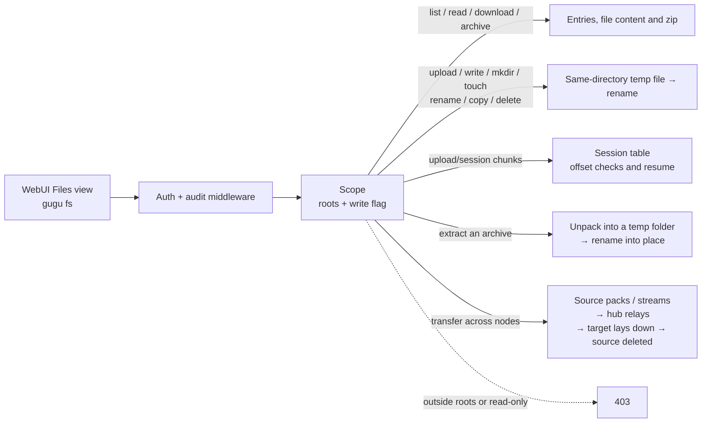
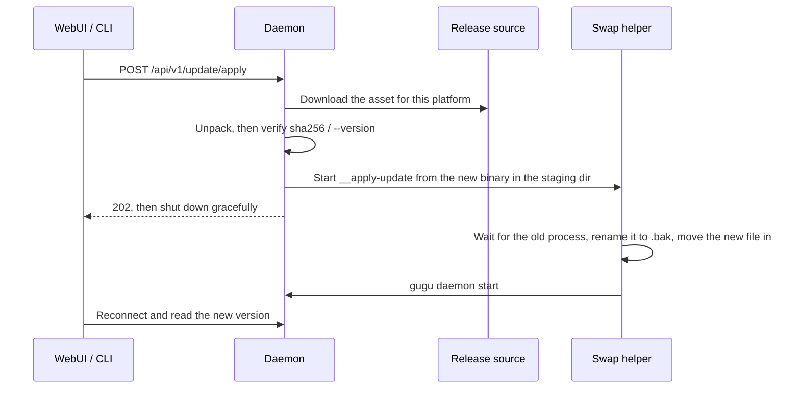

# GuguGuard (咕咕鸽进程守护)

[中文文档](./README.md)

A cross-platform process guardian and manager built with Rust. Manage your service processes via CLI and WebUI.

## Features

- **Process Management** — Start, stop, restart, auto-restart, crash recovery
- **Web Dashboard** — Dark-themed UI, dynamic forms, real-time status updates
- **CLI Tool** — Full-featured command line with colored table output
- **Log Capture** — Automatic stdout/stderr capture, in-memory ring buffer + file persistence + auto rotation
- **Health Checks** — TCP port / HTTP request monitoring; restarts only after N consecutive failures (default 3), so transient blips don't kill healthy processes
- **Exit History** — the last 5 exits (time, exit code, whether it was auto-restarted) are visible on the card and via the API; every start/exit/revival is also appended to a 30-day rolling journal that survives daemon restarts, so availability and crash frequency stay measurable
- **Resource Monitoring** — samples CPU/memory for the whole process tree (including helpers like conhost), shown on the card and in `/metrics`; `max_memory_mb` restarts a process that exceeds its memory cap
- **Resource Hard Limits (cgroup v2 / Job Object)** — on Linux every process gets its own cgroup; `cpu_max` / `memory_max` / `pids_max` are enforced by the kernel (memory overrun OOMs the whole group, task count is capped), applied before the first instruction and cleaned up on exit. On Windows the same fields land on the process tree's Job Object (CPU rate hard cap, commit-memory cap, active-process cap)
- **Metric Time Series** — one bucket per minute kept for 24 hours (CPU/memory average and peak, connection count), read through the WebUI "metrics" panel and `GET /api/v1/processes/:name/history`
- **Port Preflight & Connections** — with `listen_ports` configured, startup fails loudly when the port is already taken (naming the owner), and established connections on those ports are counted while running
- **Readiness Probe** — `depends_on` now waits for the upstream to actually serve (health check passing or ports listening), up to `ready_timeout_secs`
- **Log Alerts** — keyword hits and short bursts of output raise notifications with a cooldown, so a retry storm can't flood the bot
- **Structured Logs & Search** — each line is parsed into level, message, structured fields and an in-line timestamp (JSON / logfmt / text heuristics), so the log panel shows level badges and field chips; logs on disk are searchable by level, keyword and stream, with hit and scan-range counts
- **Operation Audit** — who did what to which process and when: write operations (start/stop, add/update/delete, reload, daemon shutdown) are appended to `logs/audit.jsonl` with result, source, client and duration, kept for 90 days; the WebUI "Operation Audit" panel and `gugu audit` filter by action, result, time and keyword
- **Built-in WebUI Terminal** — a real PTY in the browser (ConPTY on Windows, openpty on Unix): `cd`, pagers, colors and TUI programs behave normally, and output streams back live. Off by default; when enabled it is gated by API Key auth and loopback binding. Up to 4 sessions per instance, 30-minute idle timeout, and both open and close are written to the operation audit
- **Multiple Nodes** — one hub manages several machines running gugu: list them under `[[nodes]]` with their URL and Key, then switch in the WebUI top bar to start/stop processes, read logs and edit config directly. Health is probed every 5 seconds; REST proxying and WebSocket relaying happen on the hub, so remote nodes need no extra setup
- **Host Bandwidth** — combined up/down rate across physical NICs, shown in the toolbar and metrics panel, exposed in `/metrics`
- **Version Update** — the sidebar version is the entry point: check the latest release, install it in one click, and let the daemon restart itself; auto-update can be off, check-only or install, with sources from GitHub, Gitee or your own manifest
- **Alerts** — notify on unrecoverable exit / unhealthy verdict / successful auto-restart / memory-limit restart via DingTalk, WeCom, Feishu custom bots or your own webhook
- **Direct Execution** — Commands launch without a shell by default, so args with spaces or special characters aren't split or injected; set `shell = true` for shell features
- **File Management** — Browser over whitelisted directories: listing, text preview (UTF-8 / GBK auto-decoded), raw downloads and zip archives of whole directories, uploads (drag and drop, whole folders, chunked resume for large files, live progress and cancel), archive extraction (zip / tar / tar.gz into a sibling folder, overwrite confirmed), cut and paste (a move on the same node, a hub-driven transfer across nodes), creating directories and empty files, rename/move, copy, delete. Writes are off by default; once enabled they sit behind both the whitelist and the API key, and every write is audited
- **File Browser** — Server-side file browsing for quick directory and executable selection
- **API Key Auth** — Optional API key protection with WebUI login dialog
- **CORS Config** — Configurable allowed cross-origin origins
- **Process Dependencies** — `depends_on` for startup ordering with topological sort
- **Hot Config Reload** — SIGHUP (Linux) or `POST /api/v1/reload` to reload config at runtime
- **Smart Updates** — Non-runtime config changes (log paths, restart policies, etc.) don't restart the process
- **Portable Layout** — Config lives next to the binary by default; logs/PID resolve against the config folder, so the whole directory can be moved as-is
- **Auto-start on Boot** — three modes: system level (Windows Task Scheduler / Windows Service / Linux systemd) and user level (no admin rights needed), with `--dry-run` preview
- **Single Instance** — PID file lock to prevent duplicate daemons
- **Graceful Shutdown** — Ctrl+C / SIGTERM / SIGHUP signal handling
- **Cross-platform** — Windows & Linux

## Quick Start

### Install

**Option 1: Build from source**

```bash
git clone https://gitee.com/hongweifei/gugu-guard.git
cd gugu-guard
cargo build --release
# Binary at target/release/gugu
```

**Option 2: cargo install**

```bash
cargo install --git https://gitee.com/hongweifei/gugu-guard.git
```

**Option 3: prebuilt portable bundle**

Download the archive for your platform from Releases (`gugu-windows-x86_64.zip` / `gugu-linux-x86_64.tar.gz`)
and unpack it. The archive holds a single executable plus the license and an example config —
**config, PID file and logs are all created next to the binary on first run**, so the folder can be moved anywhere.

After compilation, you only need a single `gugu` binary — the WebUI is embedded at compile time, no extra files required.

### Config File (Portable)

The config **follows the program**. On startup it searches in this order, and if nothing is found it generates a commented template in the program's directory:

1. Path explicitly given with `-c` (highest priority)
2. `gugu.toml` in the **same directory as the binary** (recommended)
3. `gugu.toml` in the current working directory (handy when running from the source tree)

Relative paths inside the config (logs, PID, working dir) are resolved against **the config file's directory**, so the whole folder travels with the binary without editing anything:

```
gugu-guard/
├── gugu            # single file, WebUI embedded
├── gugu.toml       # auto-generated next to the binary on first run
├── gugu.pid
└── logs/           # process logs land here too
```

You can also copy the example and edit it:

```bash
cp config.example.toml gugu.toml
```

Edit `gugu.toml`:

```toml
[daemon]
# api_key = "your-secret-key"   # Optional, enables API + WebUI authentication

[daemon.web]
addr = "0.0.0.0"
port = 9090
# cors_origins = ["http://localhost:3000"]  # Optional, restrict CORS origins

[processes.my-app]
command = "node app.js"
working_dir = "/home/user/my-project"
auto_start = true
auto_restart = true
max_restarts = 3
restart_delay_secs = 5
max_log_size_mb = 10             # Auto-rotate logs when exceeding 10MB
stdout_log = "logs/my-app-stdout.log"
stderr_log = "logs/my-app-stderr.log"
depends_on = ["my-db"]           # Wait for my-db to start first

[processes.my-app.health_check]
type = "tcp"
port = 8080
interval_secs = 30
timeout_secs = 5
# unhealthy_restart = true       # Auto-restart on health check failure
```

### Start the Daemon

```bash
# Run in foreground (reads gugu.toml next to the binary; auto-created on first run)
gugu run

# Specify config file
gugu run -c /path/to/config.toml

# Set API Key via CLI (overrides config file)
gugu --api-key "your-secret-key" run
```

Open `http://localhost:9090` in your browser to access the web dashboard.

### Auto-start on Boot

Three modes — pick by "needs admin?" and "must it run before logon?":

| Mode | Platforms | Rights | Behaviour |
|---|---|---|---|
| `--mode task` (default) | Windows / Linux | admin / sudo | Windows Task Scheduler (`onstart`, as SYSTEM) / Linux systemd system unit |
| `--mode service` | Windows only | admin | Windows Service (AutoStart + crash recovery at 5s/10s/30s) |
| `--mode user` | Windows / Linux | **none needed** | Per-user at logon: Windows Run key / Linux `systemd --user` (add `loginctl enable-linger` to run before logon) |

```bash
# System level (admin / sudo)
gugu install                       # Windows: Task Scheduler
sudo gugu install                  # Linux: systemd system unit
gugu install --mode service        # Windows: register as a Windows Service

# User level (no privileges required, starts at logon)
gugu install --mode user

# Preview what would be written/executed; changes nothing
gugu install --mode task --dry-run
gugu uninstall --dry-run
```

Install performs a **permission pre-check** (it tells you to use sudo/admin, or to switch to `--mode user`),
then **reads the state back** (`systemctl is-enabled` / `schtasks /query` / `reg query` / `sc query`);
uninstall tolerates "not installed at all"; `--dry-run` only prints the plan.

> Paths containing spaces work: both the systemd unit and the Windows auto-start command quote their paths.

### Hot Config Reload

```bash
# Linux: send SIGHUP signal
kill -HUP $(cat gugu.pid)

# Any platform: via CLI
gugu reload

# Or call the API directly
curl -X POST http://localhost:9090/api/v1/reload
```

## CLI Usage

```bash
gugu run                          # Start the daemon (foreground)
gugu daemon start                 # Start detached in background (logs to file)
gugu daemon stop                  # Graceful stop (children → server → pid file)
gugu status                       # Show process status
gugu list                         # List configured processes
gugu nodes                        # List managed nodes with online state
gugu --node web1 status           # Operate a remote node through the hub, same syntax
gugu --node web1 logs api -l 50
gugu start <name>                 # Start a process
gugu stop <name>                  # Stop a process
gugu restart <name>               # Restart a process
gugu logs <name> [-l 100]         # View logs
gugu logs <name> --level warn -q timeout --stream stderr
                                  # Live logs filtered by minimum level / keyword / stream
gugu logs <name> --file -q timeout   # Search the on-disk log file (last 4MB by default)
gugu history <name> [-m 60]       # Metric time series (CPU/memory/connections, one bucket per minute)
gugu exits <name> [-m 60]         # Exit history and availability (persisted journal)
gugu net [-m 60]                  # Host bandwidth time series
gugu audit [-l 100] [--failed]    # Operation audit (newest first; --action by code, --since in minutes)
gugu fs ls [PATH] [--json]        # List a directory (defaults to the first whitelist root)
gugu fs cat <PATH> [--limit N]    # Preview text (UTF-8 / GBK auto-decoded; N bytes max)
gugu fs get <PATH> [-o DIR] [-r]   # Download a file; -r pulls a whole directory and keeps its layout
gugu fs put <LOCAL> <PATH> [--overwrite] [-r]  # Upload; -r pushes a directory, both show progress
gugu fs extract <PATH> [-d DEST] [--overwrite] [--no-collapse]
                                  # Unpack zip / tar / tar.gz; sibling folder by default,
                                  # --no-collapse keeps the archive's top directory
gugu fs mkdir <PATH> [-p]         # Create a directory; -p creates parents
gugu fs touch <PATH>              # Create an empty file
gugu fs mv <FROM> <TO> [--overwrite]   # Rename or move
gugu fs mv <FROM> <TO> --from-node edge
                                  # Cross-node move: source lives on edge, target on the current --node
gugu fs cp <FROM> <TO> [--overwrite]   # Copy a file or a directory
gugu fs rm <PATH> [-r]            # Delete; directories need -r
gugu add <name> -x "node app.js"  # Add a process
gugu remove <name>                # Remove a process
gugu reload                       # Reload config file
gugu update --check               # Check for a newer release (changes nothing)
gugu update                       # Download and install it, wait until the new version is up
gugu update --version 0.2.0       # Install a specific version
gugu check                        # Validate config (read-only, starts nothing)
gugu status --json                # JSON output for scripts (also: list)
gugu install                      # Register auto-start (--mode task|service|user)
gugu install --mode user          # Per-user auto-start (no admin, starts at logon)
gugu install --dry-run            # Preview only, changes nothing
gugu uninstall                    # Remove auto-start (also takes --mode / --dry-run)
```

Global options:

```bash
-c, --config <PATH>      # Config file path (default: gugu.toml next to the binary)
    --server <URL>       # Server URL to connect to
    --api-key <KEY>      # API Key (overrides config file)
    --node <NAME>        # Target node (id from gugu nodes; default local)
```

### Add Process Examples

```bash
gugu add my-api -x "python -m uvicorn main:app --host 0.0.0.0" \
  --dir /home/user/api \
  --env PORT=8000,DEBUG=false \
  --port 8000 \
  --cpu-max 50% --memory-max 512M --pids-max 128 \
  --start

gugu add frontend -x "bun run dev" \
  --dir /home/user/web \
  --no-auto-start
```

`--port` accepts repeats or a comma-separated list; ports are what enable the preflight check and
connection counting. `--no-port-check` disables the preflight, `--ready-timeout` sets how long a
dependency may take to become ready (default 60s). `--cpu-max` / `--memory-max` / `--pids-max` are
cgroup v2 hard limits on Linux and Job Object limits on Windows (see
[Resource Hard Limits](#resource-hard-limits)).

## REST API

| Method | Endpoint | Description |
|--------|----------|-------------|
| GET | `/api/v1/processes` | List all processes |
| POST | `/api/v1/processes/:name` | Create a process |
| GET | `/api/v1/processes/:name` | Get process info |
| PUT | `/api/v1/processes/:name` | Update a process |
| DELETE | `/api/v1/processes/:name` | Delete a process |
| POST | `/api/v1/processes/:name/start` | Start |
| POST | `/api/v1/processes/:name/stop` | Stop |
| POST | `/api/v1/processes/:name/restart` | Restart |
| GET | `/api/v1/processes/:name/logs?lines=100&level=warn&q=keyword&stream=stderr` | Live logs, filterable by level / keyword / stream |
| GET | `/api/v1/processes/:name/logs/search?q=keyword&level=warn&limit=200&budget_mb=4` | Search on-disk logs; returns hits plus scanned lines/bytes and truncation flag |
| GET | `/api/v1/processes/:name/config` | Get config |
| GET | `/api/v1/processes/:name/history?minutes=60` | Metric time series (one bucket per minute, up to 24h) |
| GET | `/api/v1/processes/:name/exits?minutes=60&limit=50` | Exit events and availability stats |
| GET | `/api/v1/system?minutes=60` | Host bandwidth time series and current rate |
| GET | `/api/v1/audit?limit=100&action=process.start&ok=false&q=keyword&since_minutes=60` | Operation audit records (write operations, newest first) |
| GET | `/api/v1/terminal` | Terminal availability, shell, working directory, session limit and idle timeout |
| WS | `/api/v1/terminal/ws` | Built-in terminal session (JSON frames: `input` / `resize` / `data` / `exit`) |
| GET | `/api/v1/update` | Current version, last check result, auto-update policy and install progress |
| POST | `/api/v1/update/check` | Check the latest release now (GitHub / Gitee / manifest) |
| POST | `/api/v1/update/apply` | Download and install the given or latest version; the daemon restarts after the swap |
| POST | `/api/v1/update/settings` | Switch the auto-update policy (`off` / `check` / `install`) and write it back to the config file |
| GET | `/api/v1/nodes` | Node table: local plus remote nodes with online state, latency, version, process counts |
| GET | `/api/v1/node` | This node's own info (also what the hub probes every 5 seconds) |
| ANY | `/api/v1/nodes/{node}/...` | Proxy to the same API on a remote node (method, query, body and download headers forwarded) |
| WS | `/api/v1/ws?node=web1` | Real-time push for the selected node (hub relays to the node) |
| GET | `/api/v1/stats` | Statistics |
| GET | `/api/v1/fs/roots` | Whitelisted roots and the current write mode |
| GET | `/api/v1/fs/list?path=.` | List a directory (limited by `daemon.web.fs_roots`; out-of-root paths return 403) |
| GET | `/api/v1/fs/stat?path=...` | Kind, size, mtime and read-only flag of one path |
| GET | `/api/v1/fs/read?path=...&limit=1048576` | Text preview (UTF-8 / GBK auto-decoded; binaries return a flag only) |
| GET | `/api/v1/fs/download?path=...` | Stream the raw file (UTF-8 name via RFC 5987) |
| GET | `/api/v1/fs/archive?path=...&flat=false` | Zip a path (streamed; a directory nests under its own name by default, `flat=true` lays content at the archive root; a single file becomes one entry; symlinks skipped, raw content above 2 GB refused) |
| POST | `/api/v1/fs/extract?path=...` | Unpack an archive `{path, dest?, overwrite, collapse?}` (zip / tar / tar.gz; sibling folder by default; `collapse=false` keeps the archive's top directory) |
| POST | `/api/v1/fs/transfer?from=...` | Cross-node move `{from, to, from_node?, to_node?, overwrite}`: the source packs / streams the content, the hub relays it, the target lays it down, then the source is deleted. Same node on both ends returns 400; use `/fs/rename` |
| POST | `/api/v1/fs/upload?path=...&overwrite=false` | Upload: the body is the content, streamed to a temp file then renamed |
| POST | `/api/v1/fs/upload/session?path=...` | Open a chunked session `{path, size, overwrite}`, returns `{id, offset}` |
| GET | `/api/v1/fs/upload/session/{id}` | Bytes received so far; read this offset before resuming |
| PUT | `/api/v1/fs/upload/session/{id}?offset=N` | Append one chunk; the offset must match the server's, otherwise 400 |
| POST | `/api/v1/fs/upload/session/{id}/finish` | Verify the total size and rename the temp file into place |
| DELETE | `/api/v1/fs/upload/session/{id}` | Abandon the upload and delete the temp file |
| PUT | `/api/v1/fs/write` | Save text `{path, content, create}` |
| POST | `/api/v1/fs/mkdir` | Create a directory `{path, parents}` |
| POST | `/api/v1/fs/touch` | Create an empty file `{path}` |
| POST | `/api/v1/fs/rename` | Rename or move `{from, to, overwrite}` |
| POST | `/api/v1/fs/copy` | Copy a file or directory `{from, to, overwrite}` |
| DELETE | `/api/v1/fs?path=...&recursive=false` | Delete; directories require `recursive=true` |
| POST | `/api/v1/reload` | Reload config |
| POST | `/api/v1/shutdown` | Graceful daemon shutdown (stops all children first) |
| WS | `/api/v1/ws` | Real-time status |

> When `api_key` is set, all API requests require the `Authorization: Bearer <key>` header. WebSocket connections require `?token=<key>` query parameter.
> Proxy paths are protected by the hub's own auth; remote node keys live only in the hub config and are never returned by `GET /api/v1/nodes`.

## Project Structure

```
gugu-guard/
├── crates/
│   ├── core/       # Core lib: config, process management, logging, health checks, metrics & exit journal, socket probes
│   ├── server/     # Web server: REST API, WebSocket, auth, static files
│   └── cli/        # Command line tool
├── web/            # WebUI (no build step, ES modules embedded into the binary)
│   ├── index.html
│   ├── css/        # tokens(design tokens) / layout(shell & views) / components(shared controls) / panels(panels & tables)
│   └── js/         # core(state/API/live channel/formatting) · ui(primitives/overlay stack/dialog/drawer/toast)
│                   # views(sidebar/topbar/stats/groups/process table/files) · panels(overview/logs/metrics/audit/terminal)
│                   # forms(fields/dynamic rows/health/network/alerts/file browser/form body) · main(wiring & boot)
├── config.example.toml
└── Cargo.toml      # Workspace root config
```

## Configuration Reference

When a config file has a key the schema does not know, the startup log and `gugu check` name its full
path and suggest the closest field at the same level (for example `memory_maxx (did you mean
memory_max?)`). Such keys never block startup, but they are ignored, so `gugu check` reports
"N unknown keys ignored" in its verdict. `gugu reload` and `POST /api/v1/reload` log newly introduced
unknown keys the same way.

### Daemon Configuration

| Field | Type | Default | Description |
|-------|------|---------|-------------|
| `daemon.pid_file` | string | — | PID file path |
| `daemon.log_dir` | string | — | Log directory |
| `daemon.node_name` | string | hostname | Display name of this machine in the node table; the node id stays `local` |
| `daemon.api_key` | string | — | API Key, enables auth when set |
| `daemon.webhook_url` | string | — | Alert webhook (DingTalk / WeCom / Feishu bot or your own endpoint) |
| `daemon.webhook_format` | string | `dingtalk` | Payload shape: `dingtalk` (WeCom shares it) / `feishu` / `raw` |
| `daemon.cgroup_root` | string | `/sys/fs/cgroup` | Where Linux cgroup v2 limits are created; point it at a writable subtree in containers or systemd delegation |
| `daemon.web.addr` | string | `0.0.0.0` | Listen address |
| `daemon.web.port` | u16 | `9090` | Listen port |
| `daemon.web.cors_origins` | string[] | `[]` | Allowed CORS origins (empty = allow all) |
| `daemon.web.fs_roots` | string[] | `[]` | File-management whitelist; empty means unrestricted, otherwise only these roots and their subdirectories |
| `daemon.web.fs_write` | bool | `false` | Allow file writes (upload, create, rename, copy, delete); read-only mode still browses, previews and downloads |
| `daemon.web.terminal` | bool | `false` | Enable the built-in WebUI terminal; a non-loopback bind also requires `api_key` |
| `daemon.update.enabled` | bool | `true` | Allow checking and installing; when off the update endpoints refuse outright |
| `daemon.update.provider` | string | `github` | Release source: `github` / `gitee` / `manifest` |
| `daemon.update.repo` | string | `hongweifei/gugu-guard` | Repository as `owner/name` |
| `daemon.update.manifest_url` | string | — | Manifest URL for `provider = "manifest"` |
| `daemon.update.mirror` | string | — | Download mirror prefix, either `https://mirror/` or a `{}` template; applies to assets only |
| `daemon.update.auto` | string | `off` | Auto-update policy: `off` / `check` / `install` |
| `daemon.update.check_hours` | u64 | `24` | Hours between automatic checks |
| `daemon.update.restart` | bool | `true` | Start the daemon again after the swap |
| `daemon.update.keep_backup` | bool | `true` | Keep the replaced binary as `gugu.exe.bak` |
| `daemon.update.timeout_secs` | u64 | `30` | Timeout for manifest and asset requests (5–600) |

> The daemon writes its own runtime log to `gugu-daemon.<date>.log` in `log_dir`, rotated daily (last 30 kept). All three run modes (foreground, boot task, Windows service) write the file; it also prints to the console only when stdout is a terminal.

### Process Configuration

| Field | Type | Default | Description |
|-------|------|---------|-------------|
| `command` | string | **required** | Command to execute |
| `args` | string[] | `[]` | Command arguments |
| `working_dir` | string | — | Working directory |
| `env` | map | `{}` | Environment variables |
| `auto_start` | bool | `true` | Auto-start when daemon starts |
| `auto_restart` | bool | `true` | Auto-restart on crash |
| `max_restarts` | u32 | `3` | Max consecutive crash restart attempts |
| `restart_delay_secs` | u64 | `5` | Restart delay in seconds |
| `restart_reset_secs` | u64 | `60` | After the process stays up this many seconds, its crash-restart counter resets to zero, keeping the watchdog effective long-term |
| `shell` | bool | `false` | When true, command+args are concatenated and run through a shell (pipes, etc.); default launches the executable directly |
| `stop_timeout_secs` | u64 | `10` | Stop timeout in seconds |
| `depends_on` | string[] | `[]` | Process dependencies, start in dependency order |
| `max_memory_mb` | u64 | — | Process tree memory cap; exceeding it restarts via the auto-restart path |
| `cpu_max` | string | — | Resource hard cap: `50%` / `0.5` (cores) / `50000 100000` (quota period); cgroup quota on Linux, machine-share throttling on Windows |
| `memory_max` | string | — | Resource hard cap: `512M` / `2G` / bytes; kernel OOMs the group on Linux, Job commit cap on Windows |
| `pids_max` | string | — | Resource hard cap on processes/tasks, fork-bomb protection; Windows counts processes only |
| `max_log_size_mb` | u64 | — | Log file size limit (MB), auto-rotate when exceeded |
| `unhealthy_restart` | bool | `false` | Auto-restart on health check failure |
| `listen_ports` | u16[] | `[]` | Ports this process listens on: used for the startup preflight, connection counting and dependency readiness |
| `port_check` | bool | `true` | Check that `listen_ports` are free before starting |
| `ready_timeout_secs` | u64 | `60` | How long downstream waits for this process to become ready |
| `log_alert` | table | — | Keyword/burst log alerts, see below |
| `stdout_log` | string | — | stdout log file path |
| `stderr_log` | string | — | stderr log file path |
| `log_format` | string | `auto` | Structured format for log lines: `auto` / `json` / `logfmt` / `text` |
| `encoding` | string | `auto` | Text encoding for logs: `auto` (UTF-8 first, GBK fallback) / `utf-8` / `gbk` (`cp936`) |

### Health Check

```toml
[processes.my-app.health_check]
type = "tcp"              # or "http"
port = 8080               # TCP mode
# url = "http://localhost:8080/health"  # HTTP mode
interval_secs = 30
timeout_secs = 5
fail_threshold = 3        # consecutive failures before a process is judged unhealthy (only restarts with unhealthy_restart = true)
```

### Ports, Readiness and Log Alerts

```toml
[processes.my-app]
listen_ports = [8080]     # drives the preflight, connection counting and readiness of dependents
port_check = true         # fail the start when the port is already taken, naming the owner
ready_timeout_secs = 60   # cap for waiting on this process as a dependency

[processes.my-app.log_alert]
patterns = ["panic", "exception", "error"]  # any keyword hit raises an alert (lowercase substring match)
window_secs = 10          # burst window
burst_lines = 200         # alert when the window holds this many lines, 0 disables burst detection
cooldown_secs = 300       # silence for the same alert, so a retry storm can't flood the bot
```

A downstream of `depends_on` no longer waits for "the process started" but for it to actually serve:
with a health check it waits for that to pass, otherwise for every `listen_ports` entry to be listening.
On timeout, or if the dependency exits meanwhile, that downstream is skipped for this round and a
notification is sent.

> Note: connection counts are established TCP connections on those **listening ports**, read from the
> system socket table. Host bandwidth is the sum of physical NICs, not a per-process figure — the kernel
> does not account NIC bytes per process.

### Log Format & Search

```toml
[processes.my-app]
stdout_log = "logs/my-app-stdout.log"
stderr_log = "logs/my-app-stderr.log"
log_format = "auto"       # auto: try JSON → logfmt → text per line; pin it with json / logfmt / text
encoding = "auto"         # auto: UTF-8 first, GBK fallback; pin it with utf-8 / gbk
```

- **Encoding** — the panel, WebSocket broadcasts and search decode with `encoding`: `auto` tries
  strict UTF-8 first and falls back to GBK (code page 936 on Chinese Windows). GBK output from
  `ping`, cmd built-ins and Python now reads correctly; log files always keep the raw bytes the
  process wrote, so downloads match the original

- **Parsing** — each line yields a level (`trace` / `debug` / `info` / `warn` / `error` / `fatal`;
  numeric levels accept both syslog 0-7 and bunyan/pino 10-60), a message, structured fields and an
  in-line timestamp. `level` / `msg` / `time` keys are lifted out of JSON and logfmt lines, the rest
  stays as fields, and nested objects flatten to `a.b.c`
- **ANSI handling** — the in-memory buffer, WebSocket pushes and search results have colour/cursor
  escapes stripped; files on disk keep the original bytes, so exported logs match process output
- **Live search** — `level` / `q` / `stream` on `GET /logs` filter the in-memory ring buffer
  (1000 lines per stream per process)
- **History search** — `GET /logs/search` reads backwards from the newest data; `budget_mb` (default 4,
  max 32) is the total amount read in one search: the current file first, then the `.1`…`.6` rotations
  while budget remains. It parses lines with the same parser and filters them; the response carries hit
  counts, scanned lines/bytes and a truncation flag
- **No invented timestamps** — a history line without its own timestamp is never given the capture
  time; a time filter simply excludes such lines

### Operation Audit

```bash
gugu audit                        # last 100 control-plane operations, newest first
gugu audit --failed --since 60    # failed operations in the last hour
gugu audit --action process.start --json
```

- **What is recorded** — every write request that changes state: create/update/delete, start/stop/restart,
  health check, log clear, group start/stop/restart, config reload and daemon shutdown. Read-only GET
  requests are not audited, so the audit panel's own query cannot loop into itself
- **One record** — time, action code and human-readable name, target, HTTP method and path, status,
  duration, source address, client (`gugu-cli/<version>` / WebUI / other User-Agent), auth outcome
  (`none` / `key` / `denied`), plus the failure reason (truncated to 300 characters)
- **Persistence** — appended to `<log_dir>/audit.jsonl` (default `logs/audit.jsonl`) and kept for 90 days:
  the retention window is applied on the first write of each day, and again immediately whenever the file
  passes 8 MB (newest half kept if still oversized). The newest 500 entries stay in memory for fast queries
- **Denied auth is recorded too** — a 401 lands as `denied` with source, target and path, so unauthorised
  attempts leave a trail
- **Source resolution** — the first hop of `X-Forwarded-For`, then `X-Real-IP`, else the peer address.
  Behind a reverse proxy, have it set those headers or you will see the proxy address. Those headers are
  client-controlled when the API is exposed directly, so only trust them behind a trusted proxy
- **Query** — `GET /api/v1/audit?limit=100&action=process.start&ok=false&q=ghost&since_minutes=60`:
  `action` is the action code, `ok=true/false` keeps successes or failures only, `q` matches target,
  path, source and reason, and `since_minutes` bounds the time window

### File Management

```toml
[daemon.web]
fs_roots = ["D:/projects", "/srv/apps"]   # empty means unrestricted
fs_write = true                           # defaults to false: read-only browsing
```

The **Files** view in the WebUI, the "choose file / choose directory" dialogs in the process form and
the `gugu fs` commands all share the same endpoints and whitelist. Every request is resolved to a real
path first, then checked against the roots; `..` and symlinks are expanded at that step, and anything
outside returns 403.



- **Read-only by default** — `fs_write` defaults to `false`; browsing, preview and download always work.
  Every write returns 403 with a message naming the config line to enable. The WebUI disables the write
  buttons and shows one hint instead
- **Component-wise scope** — `/data` does not cover `/database`; Windows comparison is case-insensitive.
  Without a start directory the first root is used
- **Preview rules** — at most 1 MB per read; strict UTF-8 first, GBK as fallback; a NUL byte within the
  first 8 KB marks the file binary and no body is returned. A truncated preview is not editable; saves
  are capped at 8 MB
- **Uploads** — the body *is* the file content, written to a same-directory temp file and renamed into
  place; an existing target needs an explicit `overwrite=true`. The WebUI switches files above 8 MB to a
  chunked session: 8 MB chunks are appended in order, the server validates every offset, and a resend is
  rejected outright. A dropped chunk resumes from the server's recorded offset. Unfinished uploads are
  kept in the browser's session storage, so after a reload the same file can be picked and continued
- **Downloads** — a single file streams with `Content-Disposition` carrying both an ASCII fallback and the
  RFC 5987 UTF-8 name. Directories go through `/fs/archive`: the zip is built in the system temp
  directory, deleted once the response ends, symlinks are skipped, and raw content above 2 GB is refused
  with a hint to download subdirectories
- **Extraction** — zip, tar and tar.gz / tgz are supported. The target defaults to a sibling folder named
  after the archive (`foo.zip` → `foo/`) and can be given explicitly; an existing target needs an explicit
  overwrite, and overwriting replaces the whole directory instead of merging. Entries are unpacked into a
  `.gugu-unpack-` folder next to the target and renamed into place only after every entry succeeds, so a
  failure leaves no half-built directory. A single top-level directory carrying the target's own name is
  folded up, so `foo.zip` holding `foo/` unpacks to `foo/` rather than `foo/foo/`; a differently named
  top level is kept as the author laid it out
- **Extraction limits** — `..`, absolute paths and drive letters in entry names are skipped, and symlink
  and device entries are skipped as well (a link pointing outside the roots would bypass the scope check).
  Unpacked content is capped at 2 GB and 20,000 entries; compression ratio is not limited, the byte cap
  covers zip bombs
- **Cut and paste** — the row button "Cut" records the source and its node in the tab's session storage,
  and the toolbar shows "Paste <name>" plus "Cancel". The paste target is the current directory plus the
  original name: the same node goes through `/fs/rename` (i.e. a move), a different node goes through the
  hub's `/fs/transfer`. An existing target asks for confirmation first and retries with `overwrite`. The
  clipboard holds one item, so cutting elsewhere replaces it; it survives a node switch, which is what
  makes a cross-node paste possible
- **Cross-node move** — the hub orchestrates four steps: the source packs the directory flat (a single
  file streams as is) → the hub relays through its system temp directory → the target lays it down
  (extract for directories, write-then-rename for a file) → the source is deleted. The source is removed
  only on success; a failed removal returns 500 and says the content already reached the target, rather
  than claiming success. Checks run first: source exists and is not a symlink, the target's parent exists,
  the target itself is not silently replaced
- **Transfer leftovers** — directories: `<system temp>/.gugu-transfer-*.zip` on the hub and
  `<target parent>/.gugu-move-*.zip` on the target, both removed after extraction. Single files: the target
  first writes `<target parent>/.gugu-part-*.bin` and renames it into place. All of them sit under the
  `.gugu-` prefix, so listing and archiving skip them
- **Same node belongs to rename** — `/fs/transfer` returns 400 pointing at `/api/v1/fs/rename` when
  `from_node` and `to_node` match, so the same job has a single implementation; the WebUI and CLI branch on
  that comparison themselves
- **Progress and cancel** — uploads read progress from XHR, downloads compute a percentage from
  `Content-Length` and the bytes read. The WebUI shows one transfer row with name, percentage and bytes
  received, plus a cancel button. Cancelling only aborts the request: the bytes already received stay in
  the server session, and re-picking the same file continues from that offset; "Discard" deletes the
  session and its temp file
- **Drag and drop** — dropping files or folders onto the Files view uploads them, creating directories
  first and keeping the original layout; the "Upload folder" button uses the same path
- **No half-written files** — text saves, single-request uploads and chunk appends all land in a temp file
  prefixed `.gugu-`; a failure never leaves a partial file or damages the original. Listing and archiving
  skip these transfer leftovers
- **Root protection** — deleting a directory requires `recursive=true`; a whitelist root itself cannot be
  deleted or renamed, so no single click removes the whole view's entry point
- **Audit codes** — `fs.upload` / `fs.upload.begin` / `fs.upload.chunk` / `fs.upload.abort` / `fs.write` /
  `fs.extract` / `fs.transfer` / `fs.mkdir` / `fs.create` / `fs.rename` / `fs.copy` / `fs.delete`, with the
  concrete path as the target. Audit runs before the request body is read, so write calls carry the path in
  the `path` or `from` query parameter as well (the CLI and WebUI do); custom clients can do the same to
  have the file name recorded
- **Multiple nodes** — on a remote node the view goes through the hub proxy to that machine's whitelist;
  uploads, chunk appends, extraction and archive downloads are proxied as streams and are not bound by the
  4 MB proxy body limit. A cross-node move goes the other way round: the hub calls both ends' endpoints
  itself, because one request touches two machines at once and cannot be forwarded as a whole
- **Exposure gate** — enabling writes on a non-loopback bind without an `api_key` makes the daemon refuse
  to start; read-only mode has no such restriction. Startup logs print the root count and read/write mode
- **Health check** — `gugu check` prints whether each root exists; an empty entry is a config error

### Built-in WebUI Terminal

```toml
[daemon]
api_key = "your-secret-key"      # required for 0.0.0.0 / LAN binds, or startup fails

[daemon.web]
terminal = true                  # default false; enables a real shell in the browser
addr = "127.0.0.1"               # loopback-only use may omit the API Key
```

- **A real PTY, not a line executor** — ConPTY on Windows and `openpty` on Unix (`portable-pty`), so the shell
  believes it is attached to a terminal: `cd`, `less`, colors, completion and TTY-only programs work. Output is
  streamed to the browser in chunks and rendered by xterm.js
- **Security gate** — the terminal is off by default. A bind on `127.0.0.1` / `localhost` / `::1` relies on local
  isolation; any other address (including `0.0.0.0`) requires `daemon.api_key` (or `GUGU_API_KEY` / `--api-key`),
  otherwise the daemon refuses to start. The check runs before the manager starts, so you never get a half-working
  daemon whose panel opens but whose terminal cannot
- **Auth and same-origin** — terminal routes live under the protected router and inherit API Key auth; the browser
  passes it as `?token=`. WebSockets are not constrained by the browser same-origin policy, so the handshake also
  requires `Origin` to match `Host`; without an API Key, `Host` must be a loopback address, which blocks DNS rebinding
  that points a malicious domain at 127.0.0.1. When disabled, `GET /api/v1/terminal` returns `{"enabled": false}` and
  the WebSocket returns 403 before upgrading
- **Session limits** — at most 4 concurrent sessions (the 5th gets 429); 30 minutes without input or output closes
  the session and reclaims the PTY; closing the panel, losing the network or pressing Close kills the child and
  releases the slot
- **Audit** — opening records `terminal.open` (status 101); closing records `terminal.close` (status 200, detail
  carries duration and shell). The User-Agent is the browser's; the source prefers `X-Forwarded-For` / `X-Real-IP` and
  falls back to `-` because a WebSocket upgrade has no peer address. The upgrade request is a GET, so the audit
  middleware does not see it; the terminal handler records it itself
- **Working directory** — new sessions start in the config file's directory, so relative paths from the config can
  be inspected directly with `cd logs`
- **Assets** — xterm.js 5.3.0 and fit addon 0.8.0 are vendored under `web/vendor/` (MIT, licenses alongside),
  embedded in the binary and never loaded from a CDN; upgrading them requires a rebuild
- **Protocol** — client `{"type":"input","data":"..."}` and `{"type":"resize","cols":120,"rows":30}`; server
  `{"type":"ready","shell","cwd","max_sessions","idle_timeout_secs"}`, `{"type":"data","data":"..."}` and
  `{"type":"exit","code","reason"}`

### Multiple Nodes

```toml
[daemon]
node_name = "hub"                # Display name, defaults to the hostname

[[nodes]]
name = "web1"                    # Node id: used in the URL path and by --node; not . or ..
label = "Shanghai Web"           # Display name, optional
url = "http://10.0.0.12:9090"    # Remote node address
api_key = "that node's daemon.api_key"   # required for non-loopback addresses
```

- **Topology** — only the hub needs this config. Remote nodes keep running gugu as usual and do not need to know about the hub; they only expose their HTTP port and, when needed, their own `daemon.api_key`
- **Switching is operating** — the top-bar selector repoints the process list, logs, metrics, audit and forms at that node, so start/stop and config edits apply there directly. Live status and logs follow through `WS /api/v1/ws?node=`, which the hub relays, still one push every 2 seconds
- **Health** — the hub probes each node's `GET /api/v1/node` every 5 seconds and records online state, round-trip latency, version and process counts. The top-bar dot and `gugu nodes` read the same data; when a node is offline the last error is shown in a banner
- **HTTP proxy** — `/api/v1/nodes/{node}/...` forwards method, query string, body, `Content-Type` and download headers unchanged, signing the request with that node's key; the response is streamed through, so downloading a large log does not build a copy in the hub's memory
- **Source chain** — forwarded requests carry `X-Forwarded-For`: an existing chain is kept as-is and the hub appends the peer it sees; WebSocket upgrade requests carry the same header. The node's audit and terminal sessions record the original client rather than the hub
- **CLI** — `gugu nodes` lists nodes; `--node <name>` routes any client command through the hub, e.g. `gugu --node web1 restart api`. The id is escaped as a URL path segment, and `.` / `..` are rejected before the request is sent, so they can never fold back onto the hub's own API
- **Audit** — a proxied write is recorded on the hub with the same action code, and the target is prefixed with the node id (`web1/api`) so local and remote operations stay distinguishable. In the remote node's own audit the client address is the first hop of the hub-forwarded `X-Forwarded-For`, while the client type (CLI / WebUI) is preserved from the forwarded headers
- **Security** — a node pointing at a non-loopback address must have an `api_key`, otherwise the daemon refuses to start (the same gate as the terminal); remote keys appear only in the hub config and in forwarded requests
- **Terminal** — the built-in terminal operates the machine running gugu and is local-only; the entry is hidden while a remote node is selected, so use that node's own panel when you need a shell there
- **When it applies** — the node table is read at daemon startup; restart the daemon after editing `[[nodes]]` (`gugu reload` reloads process config and daemon settings, it does not rebuild the node table)

### Resource Hard Limits

```toml
[daemon]
cgroup_root = "/sys/fs/cgroup"   # Linux only; point it at a writable subtree in containers or systemd delegation

[processes.my-app]
cpu_max = "50%"                  # half a core; also 0.5 (cores) or "50000 100000"
memory_max = "512M"              # crossing it hits the hard limit — this is not a restart
pids_max = "128"                 # process/task cap, fork-bomb protection
```

Linux uses cgroup v2 and Windows uses a Job Object. Both apply at startup: a configured limit must take
effect, and a limit that cannot be created fails the start.

- **Linux prerequisites** — the cgroup v2 unified hierarchy (`cgroup.controllers` under the mount point)
  and write access: run as root, or point `cgroup_root` at a subtree delegated to you. A missing
  cpu / memory / pids controller fails the start and names the missing one
- **Linux when it applies** — before exec, the daemon creates `<cgroup_root>/gugu/<name>-<hash>`, writes
  the limits, and the child writes itself into `cgroup.procs` between `fork` and `exec`: the whole tree
  is limited from its first instruction, with no "start it, then move it" window
- **Linux inheritance and cleanup** — children and grandchildren stay in the same cgroup; when the
  process exits or is stopped the daemon writes `cgroup.kill` and removes the directory, so no orphan
  escapes. A leftover directory from a previous run is cleared on the next start
- **Linux memory semantics** — `memory.max` is a kernel limit: crossing it triggers the cgroup OOM and
  the whole group is killed (`memory.oom.group = 1`), with `memory.swap.max = 0` so swapping cannot
  dodge the cap. The daemon only sees the exit (usually 137); `auto_restart` can bring it back
- **Windows mapping** — `memory_max` becomes the Job commit-memory cap (`JobMemoryLimit`), `pids_max`
  becomes the active-process cap (`ActiveProcessLimit`), and `cpu_max` becomes a CPU rate hard cap
  (`JOB_OBJECT_CPU_RATE_CONTROL_HARD_CAP`). Limits are written when the Job is created; the main
  process is assigned right after `spawn`, and processes it spawns inherit the same Job
- **Windows semantics** — CPU is throttled rather than killed, and `CpuRate` is a share of the whole
  machine: `cpu_max = "10%"` on a 16-logical-core host becomes 0.625% of the machine, printed in the
  start log. `memory_max` caps committed memory for the whole Job; overruns make new allocations fail
  and the process usually reports an error and exits. `pids_max` counts processes, not threads
- **Versus `max_memory_mb`** — `max_memory_mb` is the daemon's own watchdog: sample, then restart.
  `memory_max` is enforced by the OS, so the process cannot overuse before being killed. Both may be set
- **Other platforms** — configuring any limit fails the start with an explicit message; it is never
  silently ignored

### Check, Update and One-click Upgrade

```toml
[daemon.update]
provider = "github"              # github / gitee / manifest
repo = "hongweifei/gugu-guard"
auto = "check"                   # off / check / install
check_hours = 24
# mirror = "https://mirror.example.com/"   # assets only; the manifest is fetched directly
# restart = true                  # start the daemon again after the swap
```

The entry sits at the bottom of the sidebar: click the version to open "Version & Update", which shows the
current and latest versions, the release notes and the auto-update policy; "Install now" runs the download
and the swap. On the command line the same thing is `gugu update --check` and `gugu update`.



- **Why a helper process** — a running executable cannot be overwritten on Windows and cannot be written
  on Unix (ETXTBSY), so the swap has to come from another process after the old one exits. The helper runs
  from `<binary dir>/.gugu-update/<version>/`, so replacing the target does not touch itself; its output
  goes to `apply.log` in the same directory
- **Verification** — after unpacking, the new binary is run with `--version` and its answer must equal the
  target version; when the release asset carries a `digest` (GitHub) or the manifest provides `sha256`, the
  archive digest is checked as well. Files are touched only after both pass
- **Failure handling** — if the move fails after the target has been set aside, the helper puts `.bak`
  back and records the reason; with `keep_backup = true` the old binary stays as `gugu.exe.bak`, so a
  manual rollback is always one rename away
- **Port handover** — the helper starts the new daemon without inherited handles and the listening socket
  itself is marked non-inheritable, so the port is released together with the old process. While the
  address is still in `TIME_WAIT`, binding retries every 500 ms for up to 30 seconds; when the port belongs
  to another live process the bind fails at once
- **Service managers** — under systemd or the Windows service wrapper set `restart = false` and let the
  manager bring the daemon back; a second start from the helper would collide with the PID file and port
  (the new binary is already in place either way)
- **Auto-update** — `check` only checks and lights the sidebar badge; `install` runs the whole flow and
  restarts as needed. The first automatic check happens 30 seconds after startup, then every `check_hours`
- **Sources** — `github` and `gitee` read their release list APIs and skip drafts and pre-releases;
  `manifest` reads a JSON file you host:
  `{"version":"0.2.0","notes":"…","assets":{"windows-x86_64":"https://…/gugu.zip"}}`.
  Internal deployments can maintain just that file, or put a proxy prefix in front of the official
  assets with `mirror`
- **Scope** — an update acts on the binary running on this machine; while a remote node is selected the
  same entry operates on that node

## CI & Release

- **CI** (`.github/workflows/ci.yml`): on Windows and Linux it runs `cargo fmt --check`,
  `cargo clippy -- -D warnings` and `cargo test`; on `master` it also mirrors branches and tags to Gitee
  (set the `GITEE_TOKEN` secret; the step skips itself when the secret is absent)
- **Release** (`.github/workflows/release.yml`): pushing a `v*` tag builds both platform bundles and
  creates a Release with `gugu-windows-x86_64.zip` / `gugu-linux-x86_64.tar.gz`
- Equivalent local gates (same as CI):

```bash
cargo fmt --all -- --check
cargo clippy --workspace --all-targets -- -D warnings
cargo test --workspace
```

## Changelog

See [CHANGELOG.md](CHANGELOG.md) for release notes.

## License

MIT — see [LICENSE](./LICENSE)
